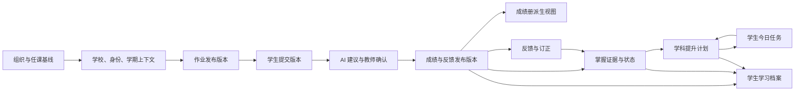

# 跨模块数据流转合同

本文件是跨模块数据流转的中央事实源。Flow ID 描述业务对象与版本如何产生、确认、传播、失效和补偿，不代表具体 API、数据库表、消息队列或事件 Topic。

关联事实源：

- 数据责任：`data-ownership-matrix.md`
- 字段与选项：`field-option-catalog.md`
- 对象状态：`core-object-state-model.md`

## 1. 流转术语

| 术语 | 定义 |
|---|---|
| 源版本 | 本次处理实际读取并锁定业务语义的对象版本 |
| 目标版本 | 本次成功流转产生的新权威对象或新版本 |
| 派生刷新 | 不产生新权威事实，只更新队列、列表、统计或搜索视图 |
| 人工确认门禁 | AI、批处理或系统建议必须由有权角色确认后才能产生正式值 |
| 业务幂等键 | 同一业务动作重复提交时识别“同一次操作”的稳定组合 |
| 失效 | 下游仍保留历史，但不能继续作为当前有效依据 |
| 补偿 | 在部分成功后恢复一致性、重试失败对象或生成反向业务版本 |
| 失败关闭 | 关键权限、审计或版本校验失败时不执行正式写入 |

执行方式：

| 方式 | 产品含义 |
|---|---|
| 即时提交 | 用户等待权威写入结果，成功后才能离开确认状态 |
| 后台处理 | 先生成任务标识，页面可离开，任务中心持续展示进度 |
| 人工确认 | 系统只产生预览、建议或草稿，有权角色确认后再写入 |
| 扇出刷新 | 一个权威写入成功后刷新多个派生视图或生成下游候选 |

## 2. P0 主闭环

## 3. Flow 索引

| Flow ID | 优先级 | 流程 | 主要模块 | 执行方式 |
|---|---|---|---|---|
| DF-001 | P0 | 学校、身份与学期上下文建立 | ACC、ORG、GOV | 即时提交、派生刷新 |
| DF-002 | P0 | 组织导入与权限刷新 | ORG、ACC、GOV | 人工确认、后台处理、对象级部分成功 |
| DF-003 | P0 | 作业发布到学生任务 | HW、SUB、APP1、TEA | 人工确认、扇出刷新 |
| DF-004 | P0 | 学生草稿到不可变提交版本 | SUB、HW、GRD、APP1 | 即时提交、后台上传 |
| DF-005 | P0 | 提交版本到 AI 初评与复核队列 | SUB、GRD、TEA | 后台处理、人工确认前置 |
| DF-006 | P0 | 教师复核到确认评分版本 | GRD、PUB、TEA | 即时提交、对象级批量 |
| DF-007 | P0 | 成绩发布与下游扇出 | PUB、SCO、APP1、APP2、INS、STU | 人工确认、对象级部分成功、扇出刷新 |
| DF-008 | P0 | 成绩修正与下游失效 | PUB、SCO、APP2、INS、PLN、STU | 即时提交、扇出刷新 |
| DF-009 | P0 | 订正提交、判定与新证据 | APP2、INS、PLN、APP1 | 即时提交、人工确认、扇出刷新 |
| DF-010 | P0 | 证据聚合到掌握状态与提升候选 | INS、PLN、STU | 后台计算、人工修正 |
| DF-011 | P0 | 提升候选到学科计划与全科协调 | PLN、INS、STU、APP1 | 人工确认、跨角色协调 |
| DF-012 | P0 | 学生执行、困难反馈与计划评估 | APP1、PLN、STU、TEA | 即时提交、扇出刷新 |
| DF-013 | P0 | 任课与身份变更后的责任交接 | ORG、ACC、GOV、HW、GRD、INS、PLN | 人工确认、权限刷新 |
| DF-014 | P0 | AI / CLI 查询、草稿、预览与执行 | AI、CLI、GOV、业务模块 | 查询即时、写入人工确认、后台执行 |
| DF-015 | P0 | 学校、身份或学期切换后的上下文失效 | ACC、AI、CLI、全业务模块 | 即时提交、失败关闭 |
| DF-016 | P0 | 高风险操作审计追加 | GOV、全业务模块 | 与业务写入同门禁、只追加 |
| DF-101 | P1 | 备课到课堂证据与作业草稿 | PREP、HW、INS | 人工确认、扇出草稿 |
| DF-102 | P1 | 考试成绩到发布、成绩册与学情 | EXM、PUB、SCO、INS、STU | 批量校验、人工确认、扇出刷新 |
| DF-201 | P2 | 排课输入到候选与正式课表 | SCH、ORG、AI | 后台计算、人工确认 |
| DF-202 | P2 | 调课 / 代课到新课表版本与通知 | SCH、ORG、GOV | 人工确认、扇出通知 |
| DF-301 | P3 | CLI 自动化授权生命周期 | CLI、GOV、AI | 人工审批、后台执行、到期失效 |

## 4. P0 Flow Contract

### DF-001 学校、身份与学期上下文建立

| 属性 | 合同 |
|---|---|
| 触发 | 用户选择学校并完成登录 / 激活，随后选择有效身份与学期 |
| 输入 | `DAT-ACC-01` School Space、`DAT-ACC-02` Membership、`DAT-ACC-03` Role Assignment、`DAT-ORG-01` Term 的当前有效版本 |
| 处理 | 校验学校状态、成员状态、身份范围和学期可用性；不允许最近使用记录替代当前授权校验 |
| 输出 | 新 `DAT-ACC-04` Active Context；刷新导航、选项范围、教师工作台或学生首页派生视图 |
| Owner 交接 | 学校管理员 / 教务维护的主数据被当前用户选择为会话上下文；用户选择不改变主数据 Owner |
| 可见性 | 只展示当前用户可进入的学校与有效身份；身份卡展示实际班级和学科范围 |
| 执行方式 | 即时提交；下游页面和选项扇出刷新 |
| 幂等键 | 用户 + School Space + Role Assignment + Term + 授权版本 |
| 失败 / 重试 | 任一授权校验失败则不建立上下文；刷新授权后可安全重试 |
| 失效 / 补偿 | 学校、成员、身份或学期失效后，当前上下文失效并进入 DF-015 |
| 审计 | 登录、激活、学校切换和身份切换进入 DF-016 |

验收标准：

1. 无有效 Membership 或 Role Assignment 时不能生成 Active Context。
2. 重复选择同一有效上下文不产生多个业务上下文版本。
3. 切换成功后旧学校数据、AI 引用和 CLI 引用不继续可执行。

### DF-002 组织导入与权限刷新

| 属性 | 合同 |
|---|---|
| 触发 | 有权管理员或教务确认已通过校验的 `DAT-ORG-11` Import Batch |
| 输入 | 导入文件快照、字段映射、处理动作、当前 `DAT-ORG-01~10` 与 `DAT-ACC-02/03` 版本 |
| 处理 | 按对象校验唯一性、引用关系、创建 / 更新 / 停用影响；阻断错误行，警告和冲突需显式处理 |
| 输出 | 对应组织主数据新版本、导入对象级结果、有效权限重算、受影响上下文失效清单 |
| Owner 交接 | 导入操作者负责批次；学校管理员接管成员 / 授权数据，教务接管学期 / 班级 / 课程 / 任课数据 |
| 可见性 | 导入预览显示创建、更新、停用和错误数量；敏感字段按最小必要展示 |
| 执行方式 | 人工确认后后台处理；允许对象级部分成功 |
| 幂等键 | Import Batch ID + 文件内容指纹 + 映射版本 + 确认版本 |
| 失败 / 重试 | 已成功对象不重复写入；失败对象修正后以新批次或失败子集重试 |
| 失效 / 补偿 | 任课、班主任、班级或成员状态变化触发 DF-013；错误停用通过反向新版本恢复，不删除历史 |
| 审计 | 上传、映射、确认、逐对象结果、权限刷新进入 DF-016 |

验收标准：

1. 未映射必填字段或存在阻断错误时不能执行导入。
2. 部分成功必须返回对象级成功 / 失败，不能显示为全部完成。
3. 任课变化后新权限生效，历史作业、成绩和计划 Owner 不被改写。

### DF-003 作业发布到学生任务

| 属性 | 合同 |
|---|---|
| 触发 | 对应任课教师在预览页确认发布作业 |
| 输入 | `DAT-HW-01~04` 当前草稿版本、`DAT-ORG-08` 任课关系、班级学生范围和发布时间规则 |
| 处理 | 校验内容项、提交方式、评分规则、反馈策略、班级权限和起止时间；发布范围展示人数 |
| 输出 | 新 `DAT-HW-05` Assignment Release；为范围内学生生成 Student Assignment 派生任务；刷新 TEA 与 APP1 |
| Owner 交接 | 任课教师继续拥有发布版本；学生只接收本人任务，不拥有作业规则 |
| 可见性 | 发布时间前学生不可见；到达发布时间后只对发布范围学生可见 |
| 执行方式 | 人工确认；权威发布即时提交，学生任务和通知扇出刷新 |
| 幂等键 | Assignment ID + 草稿版本 + 班级 / 学生范围摘要 + 发布时间 |
| 失败 / 重试 | 班级级扇出失败返回班级与学生明细；已成功学生不重复生成任务 |
| 失效 / 补偿 | 已有提交后关键规则变化必须形成新发布版本并标记受影响流程，不静默覆盖 |
| 审计 | 预览范围、确认人、发布版本、对象级结果和通知结果进入 DF-016 |

验收标准：

1. 无有效任课关系或空评分规则时不能发布。
2. 同一发布确认重复提交不产生重复学生任务。
3. 学生首页只能看到本人且已到发布时间的 Assignment Release。

### DF-004 学生草稿到不可变提交版本

| 属性 | 合同 |
|---|---|
| 触发 | 学生在作业提交摘要确认提交或重提 |
| 输入 | `DAT-HW-05`、`DAT-SUB-01` Answer Draft、`DAT-SUB-02` Submission Media、当前补交 / 重提规则 |
| 处理 | 校验本人、作业版本、截止、漏答提示、图片质检、上传完成度和重提资格 |
| 输出 | 新不可变 `DAT-SUB-03` Submission Version；旧版本标记被替代但不删除；刷新学生任务状态并触发 DF-005 |
| Owner 交接 | 学生继续拥有原始提交内容；任课教师获得有权查看与复核范围 |
| 可见性 | 提交前仅学生本人可见草稿；提交后对应任课教师可查看提交版本 |
| 执行方式 | 文本确认即时提交；媒体可后台上传，全部完成后提交版本才有效 |
| 幂等键 | Student Assignment ID + 客户端提交标识 + 草稿版本摘要 |
| 失败 / 重试 | 上传失败不生成有效提交版本；重复请求返回同一版本；断网恢复续传未完成媒体 |
| 失效 / 补偿 | 学生重提生成新版本，正在进行的旧版本批改进入“版本过期”而非自动切换 |
| 审计 | 提交、重提、迟交标记和版本替代进入 DF-016 |

验收标准：

1. 上传未完成时不能显示“已提交成功”。
2. 重复点击提交只产生一个 Submission Version。
3. 重提后旧提交、旧评分建议和旧教师决定仍可追溯。

### DF-005 提交版本到 AI 初评与复核队列

| 属性 | 合同 |
|---|---|
| 触发 | 有效 Submission Version 生成，或教师对失败版本发起安全重试 |
| 输入 | `DAT-SUB-03`、原始 `DAT-SUB-02`、`DAT-HW-02` 题目版本、`DAT-HW-03` Rubric 版本 |
| 处理 | 识别、题目切分、按题型生成建议；主观题、低置信、无法判断和规则冲突进入强制复核 |
| 输出 | `DAT-GRD-01` Recognition Result、`DAT-GRD-02` AI Grading Suggestion、Review Queue 派生项 |
| Owner 交接 | AI 是产生者；对应任课教师接管建议的采用、修正或拒绝责任 |
| 可见性 | 学生不可见 AI 内部状态、建议分和教师私密备注 |
| 执行方式 | 后台处理；过程状态可查看，业务页面保留人工路径 |
| 幂等键 | Submission Version + Assignment Item Version + Rubric Version + 评估策略版本 |
| 失败 / 重试 | 同一输入组合重试更新任务尝试次数，不重复生成有效建议版本；失败项可人工批改 |
| 失效 / 补偿 | 提交、题目或 Rubric 版本变化使旧建议失效；旧建议保留但不可继续确认 |
| 审计 | 任务启动、输入版本、结果状态、人工重试和失败原因进入 DF-016 |

验收标准：

1. AI 不可用不影响教师打开原始提交进行人工评分。
2. 低置信和主观题不能进入无人工复核的批量确认范围。
3. 输入版本变化后旧建议明确显示失效。

### DF-006 教师复核到确认评分版本

| 属性 | 合同 |
|---|---|
| 触发 | 有评分权限的教师保存逐题决定或确认合法批量范围 |
| 输入 | `DAT-SUB-03`、`DAT-GRD-01/02` 当前有效版本、`DAT-HW-03` Rubric 版本 |
| 处理 | 校验提交和规则版本未变化、分值合法、主观题已复核、修改原因完整 |
| 输出 | 新 `DAT-GRD-03` Grading Decision；全部学生 / 题目满足条件时更新 `DAT-GRD-04` 批次状态和发布准备派生项 |
| Owner 交接 | 对应任课教师成为正式评分 Owner；专项授权评分保留授权依据和实际操作人 |
| 可见性 | 发布前学生不可见确认分；教师可见 AI 建议、原始材料和本人决定 |
| 执行方式 | 单题即时提交；批量确认按对象执行并返回结果 |
| 幂等键 | Submission Version + Question ID + Teacher Decision Revision |
| 失败 / 重试 | 版本冲突阻断当前项；批量部分失败时成功项不回滚，失败项保留待复核 |
| 失效 / 补偿 | 新提交、Rubric 变化或识别修正使受影响决定进入重新确认，不删除历史 |
| 审计 | 原建议、教师决定、修改原因、授权和确认时间进入 DF-016 |

验收标准：

1. 未复核的主观题不能形成完整确认批次。
2. 批量确认返回对象级结果，不能隐藏失败项。
3. 学生在 DF-007 完成前看不到教师确认分。

### DF-007 成绩发布与下游扇出

| 属性 | 合同 |
|---|---|
| 触发 | 对应任课教师确认发布预览 |
| 输入 | 当前有效 `DAT-GRD-03/04`、`DAT-HW-04` Feedback Policy、发布学生范围和通知设置 |
| 处理 | 重新校验评分版本、权限、异常学生、反馈字段和答案开放时间；逐学生生成发布结果 |
| 输出 | `DAT-PUB-01` Result Release、每名学生 `DAT-PUB-02` Published Result；刷新 SCO、APP1、STU；生成 `DAT-APP2-01/02` 与 `DAT-INS-01` 候选证据 |
| Owner 交接 | 对应任课教师继续拥有正式成绩；学生获得本人已发布结果的查看权 |
| 可见性 | 发布成功学生立即看到允许字段；失败学生继续不可见；未发布教师备注始终隐藏 |
| 执行方式 | 人工确认；逐学生写入，允许部分成功；下游扇出刷新 |
| 幂等键 | Result Release ID + Grading Version Set + Student ID |
| 失败 / 重试 | 只重试失败学生；成功学生不重复通知和不重复创建发布版本 |
| 失效 / 补偿 | 评分版本在确认后变化则预览失效；已发布错误通过 DF-008 修正，不删除发布历史 |
| 审计 | 预览、确认、学生级结果、通知结果和开放字段进入 DF-016 |

验收标准：

1. 部分失败时学生可见性与对象级结果一致。
2. 重试失败学生不影响已成功学生的发布时间和版本。
3. SCO、APP2、INS 和 STU 能追溯同一 Published Result 版本。

### DF-008 成绩修正与下游失效

| 属性 | 合同 |
|---|---|
| 触发 | 有权限教师提交成绩修正原因和新分值 |
| 输入 | 当前 `DAT-PUB-02`、对应 `DAT-GRD-03`、关联证据、修正原因和公开说明策略 |
| 处理 | 校验修正权限、原值未变化、新值合法；计算受影响统计、错题、学情和计划依据 |
| 输出 | 新 `DAT-PUB-03` Score Revision 和新的当前发布结果引用；刷新 SCO / STU；旧 `DAT-INS-01/02` 候选依据失效并触发 DF-010；相关计划标记“依据已变化” |
| Owner 交接 | 对应任课教师仍是成绩 Owner；下游任课教师对重新确认学情和计划负责 |
| 可见性 | 学生看到当前修正分和允许的公开说明；历史版本仅授权角色查看 |
| 执行方式 | 即时提交后扇出刷新；下游重算可后台进行 |
| 幂等键 | Published Result + 原版本 + 修正操作标识 |
| 失败 / 重试 | 权威修正失败时不触发下游；下游刷新失败可重试且显示数据时间 |
| 失效 / 补偿 | 不静默改计划；计划继续保留但标记依据变化，等待对应任课教师处理 |
| 审计 | 原分、新分、原因、公开说明、操作人与所有下游失效结果进入 DF-016 |

验收标准：

1. 修正后首次分、原发布分和当前分均可追溯。
2. 学情和计划不能继续把旧分标为当前有效依据。
3. 下游刷新失败不撤销已成功的成绩修正，但必须展示待同步状态。

### DF-009 订正提交、判定与新证据

| 属性 | 合同 |
|---|---|
| 触发 | 学生提交订正，随后对应任课教师完成复核 |
| 输入 | `DAT-APP2-02` Error Item、`DAT-HW-04` 提示策略、学生订正草稿 / 图片、当前订正状态 |
| 处理 | 学生端校验提示权限和提交资格；教师端校验答案、证据和 AI 建议，确认通过 / 未通过 / 需补充 / 关闭 |
| 输出 | 新 `DAT-APP2-03` Correction Attempt、`DAT-APP2-04` Correction Decision；生成新的 `DAT-INS-01` 订正证据并触发 DF-010 |
| Owner 交接 | 学生拥有订正作答；对应任课教师拥有正式订正判定和由此形成的学科判断 |
| 可见性 | 学生只见本人订正、允许提示和教师结果；教师可见原题、首次作答、历史订正和证据 |
| 执行方式 | 学生提交即时；教师判定人工确认；证据扇出刷新 |
| 幂等键 | Error Item + Student + Attempt No + 客户端提交标识；判定使用 Attempt Version + Decision Revision |
| 失败 / 重试 | 提交失败不增加有效 attemptNo；判定重复保存返回同一版本或生成明确修订版本 |
| 失效 / 补偿 | 题目、知识点或发布结果修正时，相关证据标记来源变化并重新评估，不删除订正 |
| 审计 | 提示使用、订正提交、教师判定和状态变化进入 DF-016 |

验收标准：

1. 每次有效订正形成独立版本，不覆盖首次作答。
2. AI 建议不能直接把订正标为通过。
3. 新证据不覆盖首次成绩，只影响后续学情判断。

### DF-010 证据聚合到掌握状态与提升候选

| 属性 | 合同 |
|---|---|
| 触发 | 新证据生成、证据被修正、时间窗口变化或教师发起重新评估 |
| 输入 | 学生 + 学科 + 知识点范围内当前有效 `DAT-INS-01` 集合、已有 `DAT-INS-03` Override |
| 处理 | 按证据来源、阶段、结果、难度、时间和冲突情况计算候选状态；人工 Override 优先 |
| 输出 | 新 `DAT-INS-02` Mastery State 版本；需要提升时生成或更新 `DAT-PLN-01` Improvement Candidate；刷新 STU 摘要 |
| Owner 交接 | 系统产生候选，对应任课教师负责修正、采纳和后续学科计划 |
| 可见性 | 教师看完整证据；学生只看已开放且可解释的状态摘要 |
| 执行方式 | 后台计算；教师修正即时提交 |
| 幂等键 | Student + Subject + Knowledge Point + Evidence Version Set + Rule Version |
| 失败 / 重试 | 计算失败保留上一有效状态并显示数据时间；重试不得覆盖人工 Override |
| 失效 / 补偿 | 证据或 Override 变化使旧状态和候选失效；相关计划只标记依据变化，不自动重写 |
| 审计 | 计算依据摘要、状态变化、Override 原值 / 新值和原因进入 DF-016 |

验收标准：

1. 单一证据不能直接形成熟练掌握等强结论。
2. 人工 Override 后后台重算不能静默覆盖教师决定。
3. 候选必须引用具体证据版本和状态版本。

### DF-011 提升候选到学科计划与全科协调

| 属性 | 合同 |
|---|---|
| 触发 | 对应任课教师采纳 Improvement Candidate 或主动创建学科计划 |
| 输入 | `DAT-PLN-01`、`DAT-INS-02`、学生现有计划和任务负荷、`DAT-ORG-08/09` 任课与班主任关系 |
| 处理 | 任课教师定义目标、任务、周期、成功条件和评估时间；班主任检查全科总量、截止冲突和学生反馈 |
| 输出 | `DAT-PLN-02` Subject Plan、`DAT-PLN-04` Cross-subject Coordination、确认后生成 `DAT-PLN-03` Improvement Task 并刷新 APP1 / STU |
| Owner 交接 | 任课教师拥有学科计划；班主任只拥有协调意见；学生获得执行与反馈权 |
| 可见性 | 任课教师看本学科详情；班主任看本班全科摘要；学生只看已确认任务和目标 |
| 执行方式 | 学科教师人工确认；存在冲突时跨角色协调后再生效 |
| 幂等键 | Student + Subject + Goal + Evidence Basis Version + Plan Revision |
| 失败 / 重试 | 任课教师未确认时不生成正式任务；部分学科确认不阻塞其他学科，但班主任看到完整协调状态 |
| 失效 / 补偿 | 证据、掌握状态或任课关系变化标记计划依据 / Owner 变化，进入重新确认或 DF-013 |
| 审计 | 候选采纳 / 拒绝、计划版本、协调意见、确认人与任务生成结果进入 DF-016 |

验收标准：

1. 每个学科提升点都同步对应任课教师并由其确认。
2. 班主任不能修改学科目标、掌握判断和专业任务内容。
3. 未确认计划不能出现在学生正式任务中。

### DF-012 学生执行、困难反馈与计划评估

| 属性 | 合同 |
|---|---|
| 触发 | 学生开始 / 完成 Improvement Task、提交困难反馈，或到达计划评估时间 |
| 输入 | `DAT-PLN-03`、学生完成证据、反馈类型、关联 `DAT-PLN-02/04` 和新学习证据 |
| 处理 | 保存进度与反馈；同步对应任课教师和班主任；评估时汇总任务完成和新证据，生成保持 / 调整 / 完成建议 |
| 输出 | 任务执行记录、必要的 `DAT-STU-02` Follow-up Record、`DAT-PLN-05` Evaluation；教师确认后生成新计划版本或完成状态 |
| Owner 交接 | 学生拥有执行反馈；任课教师拥有评估决定；班主任拥有全科负担协调 |
| 可见性 | 学生看本人进度与教师反馈；任课教师看本学科；班主任看全科负荷和困难摘要 |
| 执行方式 | 进度 / 反馈即时提交；评估建议后台生成，教师人工确认 |
| 幂等键 | Improvement Task + Student + Completion / Feedback 操作标识；Evaluation 使用 Plan Version + Evidence Set |
| 失败 / 重试 | 反馈重复提交返回同一记录；同步失败显示待同步，不丢失学生本地反馈 |
| 失效 / 补偿 | 计划被调整后未完成旧任务按教师决定关闭、迁移或保留，不自动计入新版本 |
| 审计 | 任务状态、反馈、教师处理和评估决定进入 DF-016 |

验收标准：

1. 学生困难反馈同时到达对应任课教师和班主任授权视图。
2. 完成任务不自动把掌握状态改为已掌握。
3. 评估调整必须形成新版本并保留旧任务处理结果。

### DF-013 任课与身份变更后的责任交接

| 属性 | 合同 |
|---|---|
| 触发 | `DAT-ORG-08/09`、`DAT-ACC-02/03` 生效、失效或范围变化 |
| 输入 | 新旧任课 / 班主任 / 身份版本、当前未完成作业、批改、学情修正和提升计划 |
| 处理 | 重算访问范围；列出需要接管的当前工作；历史记录保留原 Owner；新教师显式确认接管未完成计划和待处理任务 |
| 输出 | 新有效 Role Assignment、权限刷新结果、责任交接任务、旧上下文失效、当前计划 Owner 新版本 |
| Owner 交接 | 教务负责组织变更；新任课教师确认接管当前学科责任；原教师保留历史版本责任记录 |
| 可见性 | 权限生效后原教师不再查看超范围新数据；新教师不自动获得无关历史私密备注 |
| 执行方式 | 组织写入成功后权限即时刷新；责任接管人工确认 |
| 幂等键 | Teaching / Role Assignment + 生效时间 + 变更版本 |
| 失败 / 重试 | 权限刷新失败时变更显示“未完全生效”并阻断敏感操作；重试不重复创建交接任务 |
| 失效 / 补偿 | 错误变更通过新反向版本恢复；不能删除已发生的访问与交接审计 |
| 审计 | 变更前后范围、批准人、权限刷新和责任接管结果进入 DF-016 |

验收标准：

1. 任课变更只影响生效时间后的权限，历史 Owner 保留。
2. 新教师未确认前，当前提升计划明确显示待交接而非自动生效。
3. 原教师失去范围后不能通过旧页面或 AI 会话继续执行。

### DF-014 AI / CLI 查询、草稿、预览与执行

| 属性 | 合同 |
|---|---|
| 触发 | 用户通过 AI 对话或 CLI 提交自然语言 / 结构化命令 |
| 输入 | `DAT-ACC-04`、`DAT-AI-01` 或 `DAT-CLI-01`、目标 Data ID 与当前版本、用户指令 |
| 处理 | 解析意图；缺参数先澄清；查询只读；生成只写业务模块草稿；修改先生成结构化预览并重新校验权限 |
| 输出 | 查询结果、业务草稿、`DAT-AI-03` Action Draft / Confirmation Task；确认后写入目标业务对象并生成 `DAT-AI-04` |
| Owner 交接 | AI / CLI 不接管业务 Owner；确认权和结果 Owner 继承目标模块 |
| 可见性 | 结果不超出当前上下文；无权限时不泄露目标是否存在；终端和对话均脱敏 |
| 执行方式 | 查询即时；复杂任务后台；所有写入人工确认，高风险进入任务中心 |
| 幂等键 | Preview / Confirmation Token + 目标对象版本 + 确认人 + 解析参数摘要 |
| 失败 / 重试 | 对象变化后预览失效；部分成功返回对象级结果，只重试失败项 |
| 失效 / 补偿 | 学校 / 身份 / 学期切换进入 DF-015；业务补偿使用目标模块正式反向版本，不由 AI 删除结果 |
| 审计 | 原指令、解析范围、预览、确认、执行结果和错误进入 DF-016 |

验收标准：

1. 缺少学校、身份、班级、学科或对象时不得自行扩大范围。
2. 聊天中的普通“好”不能确认发布成绩、权限变更和课表发布。
3. AI / CLI 与 Web 使用相同业务 Flow、Owner、幂等和审计规则。

### DF-015 学校、身份或学期切换后的上下文失效

| 属性 | 合同 |
|---|---|
| 触发 | 用户切换 School、Role Assignment 或 Term，或当前上下文被 DF-002 / DF-013 失效 |
| 输入 | 旧 `DAT-ACC-04`、未提交页面草稿、`DAT-AI-01`、`DAT-CLI-01` 和进行中确认任务 |
| 处理 | 提示处理未保存草稿；停止旧上下文新写入；旧 AI / CLI 会话转只读；取消或失效未确认预览 |
| 输出 | 新 `DAT-ACC-04`；旧会话与预览失效标记；导航、缓存、选项和派生视图重新加载 |
| Owner 交接 | 用户选择新上下文；任何业务对象 Owner 不因上下文切换改变 |
| 可见性 | 新上下文不显示旧学校数据；旧会话可按权限查看历史但不可继续执行 |
| 执行方式 | 即时、失败关闭 |
| 幂等键 | User + Old Context Version + New Context Selection |
| 失败 / 重试 | 新上下文建立失败时保留旧上下文只读或返回选择页，不进入混合状态 |
| 失效 / 补偿 | 切回原上下文必须重新查询对象和生成新预览，不复活旧确认 token |
| 审计 | 上下文切换、旧预览失效和进行中任务处理进入 DF-016 |

验收标准：

1. 切换学校后旧学校 AI / CLI 会话不能继续执行。
2. 未保存表单必须明确保存、放弃或取消切换。
3. 切回旧上下文也必须重新校验权限和对象版本。

### DF-016 高风险操作审计追加

| 属性 | 合同 |
|---|---|
| 触发 | 登录、查询敏感数据、导出、授权、发布、修正、批量修改、AI / CLI 执行或课表发布 |
| 输入 | actor、当前身份、学校、action、target、before / after、reason、source、业务结果 |
| 处理 | 脱敏后生成只追加审计；高风险正式写入必须具备可关联审计结果 |
| 输出 | 新 `DAT-GOV-03` Audit Event；业务对象保存 audit reference |
| Owner 交接 | 业务对象仍由原 Owner 负责；审计记录由学校管理员治理 |
| 可见性 | 审计查看按范围授权；无权用户不能通过审计发现敏感对象 |
| 执行方式 | 与高风险写入同一成功门禁；查询审计按学校策略执行 |
| 幂等键 | Business Operation ID + Action + Target Version |
| 失败 / 重试 | 高风险审计无法追加时业务写入失败关闭；重复重试返回同一审计引用 |
| 失效 / 补偿 | 审计不可删除或修改；业务补偿产生新的反向操作审计 |

验收标准：

1. 每个高风险写入都能定位唯一业务操作与审计事件。
2. 审计失败时不能出现“业务已成功但无审计”的结果。
3. 补偿、撤销和重试均形成独立可关联审计事件。

## 5. P1-P3 Flow Contract

### DF-101 备课到课堂证据与作业草稿

| 属性 | 合同 |
|---|---|
| 触发 | 教师确认 Lesson Plan、开始 / 结束课堂，或从计划生成作业草稿 |
| 输入 | `DAT-PREP-01`、课程 / 班级上下文、课堂活动和学生参与结果 |
| 处理 | 课堂会话锁定计划版本；形成性结果与正式成绩分离；生成作业时只复制允许内容和课程上下文 |
| 输出 | `DAT-PREP-02`、`DAT-PREP-03`；可选生成 `DAT-HW-01~04` 草稿，需教师重新确认后进入 DF-003 |
| Owner 交接 | 对应任课教师拥有备课、课堂证据和生成的作业草稿 |
| 幂等键 | Lesson Plan Version + Class + Classroom Session ID；作业草稿使用 Session + Create Draft Operation |
| 失败 / 补偿 | 课堂异常中断保留已产生证据并标记不完整；作业草稿失败不影响课堂记录 |
| 验收 | 课堂练习不经评分确认不进入正式成绩；从教案生成作业仍走 HW-001 完整校验 |

### DF-102 考试成绩到发布、成绩册与学情

| 属性 | 合同 |
|---|---|
| 触发 | 教务创建考试、教师录入 / 导入并确认学科成绩、教务确认发布 |
| 输入 | `DAT-EXM-01/02`、`DAT-EXM-04` 批次、教师确认的 `DAT-EXM-03`、可选 `DAT-EXM-05` |
| 处理 | 校验班级 / 学科范围、特殊状态、满分、审核和综合规则版本 |
| 输出 | 已审核 Exam Score / Aggregate Result 发布版本；刷新 SCO / STU；按学校规则生成 INS 证据 |
| Owner 交接 | 教务负责考试口径与发布；对应任课教师负责学科原始成绩 |
| 幂等键 | Exam + Subject + Student + Score Revision；发布使用 Exam Release ID + Score Version Set |
| 失败 / 补偿 | 科目级部分失败不发布无效科目；规则变化不追溯重写历史发布结果 |
| 验收 | 综合结果可追溯原始分、权重、舍入和规则版本；学生只见已发布内容 |

### DF-201 排课输入到候选与正式课表

| 属性 | 合同 |
|---|---|
| 触发 | 教务确认排课输入与 `DAT-SCH-01` Constraint Set 后启动求解 |
| 输入 | 学期、班级、课程、任课、教室、校历和约束版本 |
| 处理 | 校验缺失输入；生成多个候选及硬 / 软冲突、评价口径；教务调整后实时复检 |
| 输出 | `DAT-SCH-02` Schedule Candidate；教务确认后生成 `DAT-SCH-03` Timetable Version 并刷新教师 / 班级 / 教室视图 |
| Owner 交接 | 求解器产生候选，教务选择、调整并发布正式课表 |
| 幂等键 | Scheduling Job + Input Version Set + Constraint Version + Solver Policy Version |
| 失败 / 补偿 | 输入或约束变化使旧候选失效；有硬冲突不可发布；发布失败不向学生展示 |
| 验收 | 候选有评价口径；人工调整实时检查；正式课表只能由教务确认发布 |

### DF-202 调课 / 代课到新课表版本与通知

| 属性 | 合同 |
|---|---|
| 触发 | 授权角色选择已发布课程实例并提交调课、代课、停课或补课请求 |
| 输入 | 当前 `DAT-SCH-03`、原课程实例、目标时段 / 教室 / 教师、原因和通知范围 |
| 处理 | 实时冲突检查；按学校规则审批；确认受影响教师、学生、班主任和场地 |
| 输出 | `DAT-SCH-04` Schedule Change、新 `DAT-SCH-03` 版本、对象级通知结果和审计 |
| Owner 交接 | 授权发起人创建草稿，教务或指定审批人确认生效 |
| 幂等键 | Original Lesson Instance + Change Request ID + Preview Version |
| 失败 / 补偿 | 部分通知失败不撤销已生效课表，但必须可重试；错误变更用撤回 / 反向新版本处理 |
| 验收 | 原安排、新安排、原因、审批和通知结果完整可追溯 |

### DF-301 CLI 自动化授权生命周期

| 属性 | 合同 |
|---|---|
| 触发 | 学校管理员创建或批准自动化授权，任务按计划 / 外部调用执行 |
| 输入 | `DAT-CLI-02` 范围、命令域、动作、有效期、最大影响量和执行身份 |
| 处理 | 每次运行重新校验授权、上下文、目标数量和业务 Flow；高风险动作仍按明确授权门禁 |
| 输出 | 自动化执行任务、目标业务对象版本、`DAT-AI-04` / `DAT-GOV-03` 执行记录 |
| Owner 交接 | 学校管理员拥有授权；业务结果 Owner 继承目标模块；自动化执行者不接管业务责任 |
| 幂等键 | Automation Grant + Schedule / External Invocation ID + Target Version Set |
| 失败 / 补偿 | 超范围、过期或超过最大影响量失败关闭；部分成功只重试失败对象 |
| 验收 | 授权到期立即失效；自动化不能默认发布成绩、修改权限或发布课表 |

## 6. 下游失效与重新确认矩阵

| 上游变化 | 直接受影响对象 | 处理 | 不允许行为 |
|---|---|---|---|
| Assignment Item 版本变化 | Submission Draft、Recognition、Grading Suggestion | 未提交草稿提示更新；已提交保持原题版本；新处理使用新版本 | 静默替换已提交题目 |
| Rubric 版本变化 | AI Suggestion、Grading Decision、Release Preview | 旧建议失效；受影响教师决定重新确认；发布预览失效 | 用新规则重写历史确认分 |
| 新 Submission Version | 旧 Review Queue、AI Suggestion、Grading Decision | 旧项标记版本过期；教师显式选择新版本 | 自动把教师从旧版本切到新版本并丢失上下文 |
| Grading Decision 修订 | Result Release Preview | 预览失效并重新生成 | 继续使用旧确认分发布 |
| Published Result 修正 | SCO、APP2、INS、STU、PLN | 权威成绩立即更新；证据和掌握重算；计划标记依据变化 | 静默改写计划目标和历史反馈 |
| Mastery Evidence / Override 修正 | Mastery State、Improvement Candidate、Subject Plan | 状态和候选重算；有效计划要求教师重新评估 | 后台重算覆盖人工 Override |
| Teaching Assignment 变化 | Role Assignment、待办、学情、计划 Owner | 权限刷新并生成责任交接 | 新教师自动接管未确认计划，或原教师继续访问新数据 |
| Class / Student 关系变化 | 新任务范围、学生目录、权限 | 历史保留原班级；未来任务进入新班级 | 把历史成绩迁写成新班级事实 |
| School / Role / Term 上下文变化 | AI、CLI、页面预览和派生缓存 | 旧上下文只读，重新查询和预览 | 复活旧确认 token |
| Exam Aggregate Rule 变化 | 后续综合结果 | 新规则仅用于规定生效点后的发布 | 追溯重写已发布综合成绩 |
| Scheduling Input / Constraint 变化 | Schedule Candidate、Timetable Preview | 旧候选失效并重新计算 | 发布基于旧约束的候选 |

## 7. 跨流失败与补偿规则

1. 权威写入失败时不触发下游扇出。
2. 权威写入成功、派生刷新失败时保留权威结果，显示“待同步”并只重试失败消费者。
3. 批量操作必须返回对象级成功、失败、阻断原因和是否可重试。
4. 重试必须复用业务幂等键；已成功对象不得重复生成版本、通知或任务。
5. 撤销不是删除历史，而是生成反向版本、撤回状态或修正版本。
6. 权限、版本或强制审计校验失败时一律失败关闭。
7. 学生端弱网允许本地草稿，但“已提交”“已发布”“已通过”等正式状态必须来自服务端权威结果。

## 8. Flow 评审与验收门禁

1. 新增跨模块写入前必须先新增或引用 Flow ID。
2. Flow 引用的每个 Data ID 必须存在于 `data-ownership-matrix.md`。
3. 每条 P0 Flow 必须包含触发、输入、输出、Owner 交接、可见性、幂等、失败、失效、审计和验收。
4. Mock 接口必须能模拟成功、处理中、部分成功、失败、重复请求、版本冲突和下游待同步。
5. QA 必须至少验证主路径、重复提交、部分失败、权限变化、上游版本变化和安全重试。

